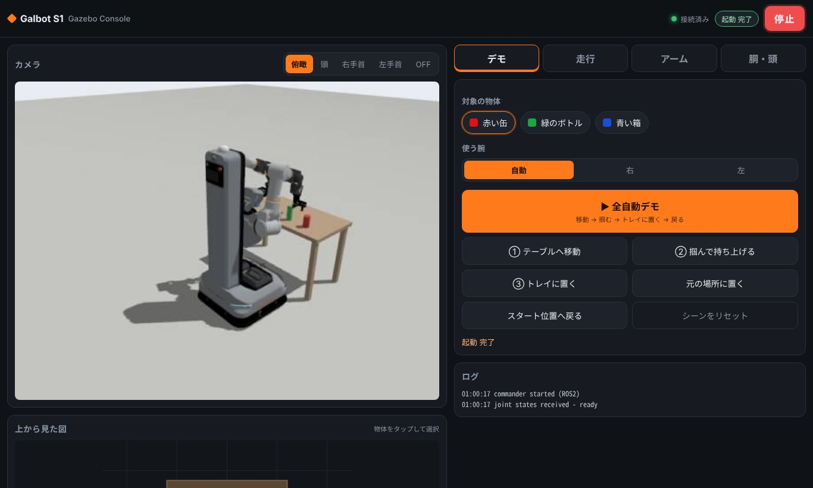
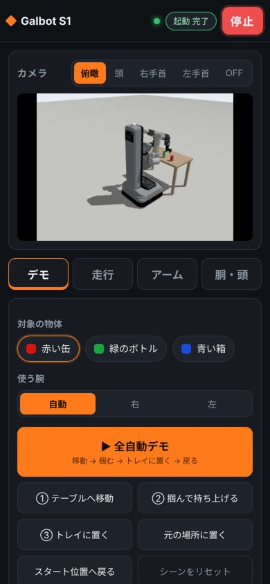
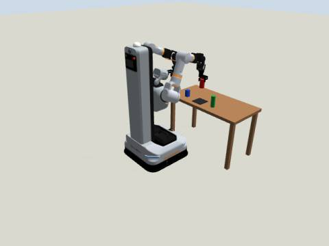
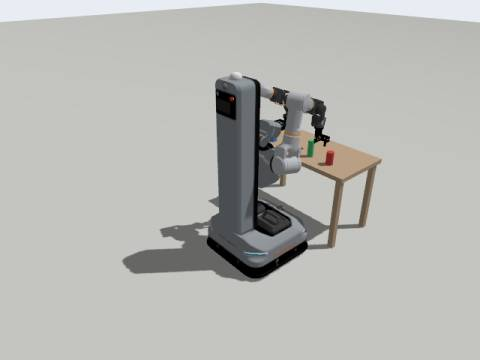

# galbot_s1_gazebo

[Galbot S1](https://github.com/GalaxyGeneralRobotics/galbot_s1_description) を Gazebo で動かすための環境です。
**ROS 1 (Noetic + Gazebo Classic 11)** と **ROS 2 (Jazzy + Gazebo Harmonic)** の両方に対応し、
走行・腕・グリッパ・胴・頭の操作と「机の上の物を掴んでトレイに置く」デモを **Web ブラウザから** 実行できます。

| Web UI (PC) | Web UI (スマホ) |
|---|---|
|  |  |

| ROS 1 / Gazebo Classic: 缶を持ち上げて運ぶ | ROS 2 / Gazebo Harmonic: トレイに置く |
|---|---|
|  |  |

```
ブラウザ (PC / スマホ)
   │  http://<host>:8000         ws://<host>:9090
   ▼                                  ▼
galbot_s1_web (静的ページ) ──── rosbridge ────┐
                                              │ /galbot/command, /galbot/status, /cmd_vel, カメラ
                                              ▼
galbot_s1_control  commander (IK・把持・デモ) / base_controller (全方向移動) / camera_relay
                                              │ ros_control (ROS1) / ros2_control (ROS2)
                                              ▼
galbot_s1_gazebo   Gazebo Classic 11  or  Gazebo Harmonic  (テーブル + 物体 + トレイ)
galbot_s1_description  公式 URDF から変換したモデル (メッシュ・慣性・関節)
```

## パッケージ

| パッケージ | 内容 |
|---|---|
| `galbot_s1_description` | 公式 URDF を xacro 化したロボットモデル。glTF メッシュを COLLADA に変換 (Gazebo Classic は glTF を読めないため)。`tools/import_upstream.py` で公式リポジトリから再生成できます |
| `galbot_s1_gazebo` | ワールド (テーブル・物体・トレイ・俯瞰カメラ)、コントローラ設定、起動ファイル、補助プラグイン (C++) |
| `galbot_s1_control` | ROS1/ROS2 共通の Python ノード (小さな互換レイヤで同じコードが rospy / rclpy で動きます) |
| `galbot_s1_web` | ブラウザ用コンソール (外部ライブラリなしの HTML/JS、オフラインでも動作) |

すべてのパッケージは 1 つの `package.xml` / `CMakeLists.txt` で catkin と ament_cmake の両方に対応しています (`$ROS_VERSION` で切り替え)。

## 動作環境

| | ROS 1 | ROS 2 |
|---|---|---|
| ディストリビューション | Noetic (Ubuntu 20.04) | Jazzy (Ubuntu 24.04) |
| シミュレータ | Gazebo Classic 11 | Gazebo Harmonic (gz-sim 8) |
| 起動 | `roslaunch galbot_s1_gazebo sim.launch` | `ros2 launch galbot_s1_gazebo sim.launch.py` |

ROS 2 Humble + Gazebo Fortress は対象外です (Fortress は glTF 非対応で、把持用の C++ システムプラグインも Harmonic の API を使っています)。
Ubuntu 22.04 の PC でも Docker を使えば両方とも動きます。

## Docker で動かす (おすすめ)

リポジトリを取得します。

```bash
git clone https://github.com/mamoru1126/galbot_s1_gazebo.git
cd galbot_s1_gazebo
```

イメージを作ります (初回は 10〜20 分ほどかかります)。

```bash
./scripts/docker_build.sh jazzy
./scripts/docker_build.sh noetic
```

起動します。Gazebo の画面が開き、Web UI が `http://localhost:8000` で使えます。

```bash
./scripts/docker_run.sh jazzy
```

ROS 1 版は次のとおりです。

```bash
./scripts/docker_run.sh noetic
```

主なオプションです。

```bash
./scripts/docker_run.sh jazzy --headless
./scripts/docker_run.sh jazzy --no-gpu
./scripts/docker_run.sh jazzy -- cameras:=false
./scripts/docker_run.sh jazzy --shell
```

- `--headless` : Gazebo の画面を出さずに起動 (ブラウザだけで操作)
- `--no-gpu` : NVIDIA GPU を渡さない (NVIDIA Container Toolkit が入っていれば自動で `--gpus all` を付けます)
- `-- <launch 引数>` : 起動ファイルへの引数 (例: `cameras:=false` でカメラを無効化して軽くする)
- `--shell` : コンテナ内の bash に入る

同じネットワークのスマホからは `http://<PC の IP アドレス>:8000` を開いてください (ポート 8000 と 9090 を使います)。

## ネイティブでビルドする

### ROS 1 Noetic

```bash
mkdir -p ~/galbot_ws/src
cd ~/galbot_ws/src
git clone https://github.com/mamoru1126/galbot_s1_gazebo.git
cd ~/galbot_ws
source /opt/ros/noetic/setup.bash
rosdep install --from-paths src --ignore-src -y
catkin_make
source devel/setup.bash
roslaunch galbot_s1_gazebo sim.launch
```

### ROS 2 Jazzy

```bash
mkdir -p ~/galbot_ws/src
cd ~/galbot_ws/src
git clone https://github.com/mamoru1126/galbot_s1_gazebo.git
cd ~/galbot_ws
source /opt/ros/jazzy/setup.bash
rosdep install --from-paths src --ignore-src -y
colcon build
source install/setup.bash
ros2 launch galbot_s1_gazebo sim.launch.py
```

### 起動引数 (ROS1 / ROS2 共通)

| 引数 | 既定値 | 説明 |
|---|---|---|
| `gui` | `true` | `false` で Gazebo を画面なしで起動 |
| `cameras` | `true` | 頭・両手首カメラ (と Web への中継) |
| `web` | `true` | rosbridge と Web サーバを起動 |
| `web_port` / `rosbridge_port` | `8000` / `9090` | ポート番号 |
| `rviz` | `false` | RViz を起動 |

RViz でモデルだけ確認したいときは `roslaunch galbot_s1_description display.launch` / `ros2 launch galbot_s1_description display.launch.py` です。

## Web UI

`http://<host>:8000` を開くと、カメラ映像 (俯瞰 / 頭 / 右手首 / 左手首)、上から見た図、操作パネルが表示されます。右上の **停止** ボタン (またはスペースキー) はいつでもすべての動作を止めます。

- **デモ** : 物体 (赤い缶 / 緑のボトル / 青い箱) を選び、「▶ 全自動デモ」で *テーブルへ移動 → 掴んで持ち上げる → トレイに置く → スタート位置へ戻る* を実行します。各ステップを個別に実行するボタンと「シーンをリセット」もあります。腕は物体の位置から自動で選びます (左右の指定も可)。
- **走行** : ジョイスティックで全方向移動、⟲⟳ で旋回。キーボードは W/S 前後・A/D 左右・Q/E 旋回。
- **アーム** : 手先を前後・左右・上下・回転 (押し続けで連続)、グリッパの開閉、7 関節のスライダ、姿勢プリセット。
  「閉じる/掴む」は指の間に物体があればそれを掴みます。
- **胴・頭** : リフト (0〜0.735 m) と首の左右・上下。

## デモの中身

1. 物体が腕の届きやすい位置 (ロボットから前方 0.62 m・横 0.25 m) に来るように、ベースを全方向移動で位置合わせ
2. IK (減衰最小二乗法・関節制限つき) で真上からの把持姿勢を計算し、物体の上 12 cm へ移動
3. 直線経路 (1 cm 刻みの IK) で下降し、物体の幅に合わせてグリッパを閉じて把持
4. 持ち上げ → 他の物の上を通れるように胴 (リフト) を上げてトレイの位置まで移動 → 胴を戻して下降し、離す → スタート位置へ戻る

GE103IN グリッパは「固定爪 + 四節リンクで動く指」の構造で、指と掌の位置関係から物体の上部をつまむ形になります。
シミュレーション上の把持は、指を物体に合わせて閉じたうえで物体を手首リンクに固定する方式 (Gazebo でよく使われる grasp attach) で、物理接触だけで保持するより安定します。

## 実装メモ

- **ベースの移動** : 公式 MuJoCo モデルと同様に、ベースを平面上で速度制御される剛体として動かします (Classic は自作プラグイン `libgalbot_planar_base_classic.so`、Harmonic は `VelocityControl` システム)。4 輪のステア角と回転はスワーブ駆動の逆運動学で計算して動かしています (見た目用。車輪は摩擦ゼロの球で床に接します)。
- **関節の制御** : 腕・グリッパ・胴・頭・ステアは位置、駆動輪は速度の `JointGroup*Controller` です。軌道 (最小加加速度の時間スケーリング) は commander が 50 Hz で生成します。Classic では PID なしの位置インターフェイス (キネマティックに関節角を設定) なので、ゲイン調整なしで安定します。
- **把持・物体管理** : `/galbot/sim/attach` `/galbot/sim/detach` `/galbot/sim/set_model_pose` (std_msgs/String) を、Classic ではワールドプラグイン、Harmonic ではシステムプラグイン (+ ros_gz_bridge) が処理します。物体の位置は `/galbot/objects/<name>/odom` で配信されます。
- **ROS1/ROS2 共通コード** : `galbot_s1_control/ros_compat.py` が publisher / subscriber / パラメータ / 時刻 / TF を吸収します。

### commander への JSON コマンド (`/galbot/command`, std_msgs/String)

Web UI と同じことを `rostopic pub` / `ros2 topic pub` やスクリプトから行えます。

```json
{"type": "task", "name": "demo", "object": "red_can"}
{"type": "task", "name": "pick", "object": "blue_box", "arm": "auto"}
{"type": "task", "name": "place", "target": "tray"}
{"type": "task", "name": "home"}
{"type": "reset_scene"}
{"type": "stop"}
{"type": "pose", "name": "ready"}
{"type": "jog", "arm": "right", "dx": 0.02, "dy": 0.0, "dz": 0.0, "dyaw": 0.0}
{"type": "gripper", "arm": "left", "action": "close"}
{"type": "joint", "name": "right_arm_joint4", "position": 1.2}
{"type": "torso", "position": 0.4}
{"type": "head", "pan": 0.0, "tilt": -0.4}
```

状態は `/galbot/status` (std_msgs/String, JSON, 5 Hz) に出ます。走行は普通に `/cmd_vel` (geometry_msgs/Twist) でも動きます。

## シーンを変える

`galbot_s1_gazebo/config/scene.yaml` (テーブル・トレイ・物体・俯瞰カメラ) を編集し、ワールドを再生成します。

```bash
cd galbot_s1_gazebo
python3 scripts/generate_worlds.py
```

## 公式モデルの更新を取り込む

```bash
git clone https://github.com/GalaxyGeneralRobotics/galbot_s1_description.git /tmp/galbot_s1_description
python3 galbot_s1_description/tools/import_upstream.py /tmp/galbot_s1_description
```

## テスト (CI)

GitHub Actions (`.github/workflows/ci.yml`) で Noetic と Jazzy の Docker イメージをビルドし、
シミュレータを画面なしで起動して「走行・手先移動・グリッパ・全自動デモ (右腕) ・左腕での把持と戻し・リセット」まで
Web UI と同じコマンドで実行して確認しています (触っていない物体が動いていないかもチェック)。
Web UI のスクリーンショット、カメラ画像、起動ログは Actions の成果物 (artifact) `sim-noetic` / `sim-jazzy` に保存されます。

## トラブルシューティング

- **Gazebo の画面が出ない (Docker)** : ホストで `xhost +local:docker` を実行してから起動してください。リモート環境なら `--headless` で Web UI だけ使えます。
- **Web UI が「rosbridge に接続できません」** : ポート 9090 がファイアウォールで閉じていないか確認してください。別ポートにした場合は `http://<host>:8000/?ws=ws://<host>:<port>` で指定できます。
- **動作が重い** : `cameras:=false` でカメラを止めるか、GPU を使ってください (`--gpus all` が付くよう NVIDIA Container Toolkit を入れる)。
- **初回起動が遅い (Classic)** : モデルデータベースへの接続待ちが出ることがあります。ワールドは外部モデルを使っていないので、そのまま待てば起動します。

## ライセンス

ロボットモデル (メッシュ・URDF) は [GalaxyGeneralRobotics/galbot_s1_description](https://github.com/GalaxyGeneralRobotics/galbot_s1_description) (Apache License 2.0) からの派生です。変更点は `galbot_s1_description/NOTICE` を参照してください。
このリポジトリのその他のコードも Apache License 2.0 としています。
